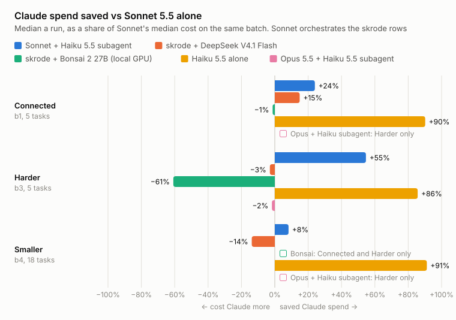

# skrode

An MCP server that lets Claude Code hand a well-specified coding task to a cheaper model, a
local one or a hosted one, and accept the work only when the task's checks pass.

**Status: concluded, not maintained.** The bet was that this would spend less Claude quota on
mechanical work at the same quality. A benchmark of 28 real changes from public Python
repositories says it does not. Claude's side of the handoff (writing the job, waiting on it,
reviewing the branch) costs about as much as doing the work. A plain Claude Code subagent on
Haiku 5.5 was the only Sonnet-orchestrated setup that saved anything, and Haiku 5.5 working
alone, added later, passed every check for 93% less. This repository is published as the
record: the code, the tasks, the raw results and the steps to rerun them.

| Row | Checks passed | Median Claude $ a run | Saved vs Sonnet alone |
| --- | --- | --- | --- |
| Sonnet alone | 84 / 84 | 0.113 | - |
| Sonnet + Haiku 5.5 subagent | 84 / 84 | 0.095 | **+13%** (+55% on the harder tasks) |
| Sonnet + skrode + DeepSeek V4.1 Flash | 84 / 84 | 0.113 | -6% |
| Sonnet + skrode + Bonsai 2 27B (local GPU) | 19 / 20 | 0.156 | -11% |
| Haiku 5.5 alone (added 21 Oct) | 84 / 84 | 0.008 | **+93%** |
| Opus 5.5 + Haiku 5.5 subagent (added 21 Oct) | 15 / 15 | 0.303 | -2% on the harder tasks |

Saved is the median per-run saving as a share of Sonnet's median cost; dollars are Claude
Code's own cost figure, the stand-in for quota. The Bonsai row ran only the 10 connected and
harder tasks, the Opus row only the 5 harder ones. The checks are the only quality measure, and
every row clears nearly all of them. The full results, method, limits and rerun steps are in [`docs/benchmark.md`](docs/benchmark.md).

<picture>
  <source media="(prefers-color-scheme: dark)" srcset="docs/img/bench-saved-dark.svg">
  
</picture>

`bench/chart.py` draws this chart from `bench/results/`.

## How it works

Claude Code calls `run_local_subagent` with a task, the files to touch and the commands that
must pass. skrode creates a git worktree on its own branch and runs a small agent loop there
(five tools: read, write, edit, bash, grep) against an OpenAI-compatible endpoint on
127.0.0.1, with the model's commands sandboxed by bubblewrap and no network. It then runs the
acceptance commands itself, retries with the failure output, and returns a short record:
`passed`, `failed` or `escalate`, under about 1.5k tokens. Claude reads the branch only if it
decides to review it. [`docs/escalation.md`](docs/escalation.md) lists when a job escalates.

The rules it holds to: the worker talks to 127.0.0.1 unless configured otherwise; a job never
moves to another model silently; exit 0 is not verification; skrode never touches Anthropic
credentials; protected tests are never edited.

## Repository

| Path | What it is |
| --- | --- |
| `skrode/` | The server, the worker and the bench harness (`benchprep`, `benchrun`, `benchsummary`) |
| `bench/tasks/` | The 28 bench tasks: specs, checks and upstream commits ([README](bench/tasks/README.md)) |
| `bench/results/` | The raw results the tables come from |
| `bench/forwarder.py`, `bench/gpu-batch.sh`, `bench/sampler.py`, `bench/chart.py` | Bench tooling: the DeepSeek pass-through, the GPU batch, the power sampler, the README chart |
| `profiles/` | Per-model request settings (Bonsai, DeepSeek Flash) |
| `prompts/worker.md`, `schemas/` | Every message sent to the worker; the JSON Schemas for arguments, records and reports |
| `tests/` | pytest; no test needs a model server or the network |

## Running it

Python 3.12+ and [uv](https://docs.astral.sh/uv/):

    uv sync --frozen
    scripts/verify.sh                                    # ruff and the test suite
    claude mcp add skrode -- uv --directory "$PWD" run skrode

The default worker is a llama-server on 127.0.0.1:8080 serving the model under the alias
`local`; see [`docs/benchmark.md`](docs/benchmark.md#the-model-server) for the setup the bench
used. Only Claude Code was tested as a client.

## Licence

Apache-2.0. The bench tasks' upstream code keeps its own licence (see
[`bench/tasks/README.md`](bench/tasks/README.md#licence)).
