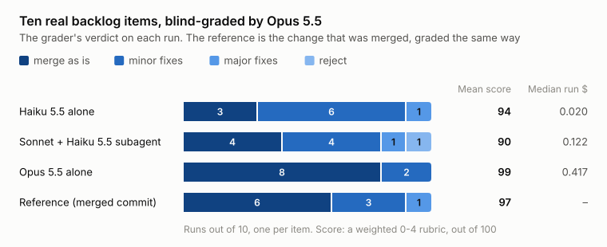

# Benchmark: does handing coding work to a cheaper model save Claude quota?

skrode lets Claude Code hand a written spec to another model. The other model works in its own
git worktree, and the job counts only when the spec's checks pass there. The bet was that
Claude would spend less on mechanical work at the same quality. This bench measured it on 28
real changes from public Python repositories, 3 runs each, on 16 October 2026.

**Result: it did not.** With Sonnet 5.5 as the orchestrator, every row passed every check, so
the rows differ only in cost. A local or hosted worker behind skrode cost Claude slightly
*more* than Sonnet doing the work alone. Writing the task, waiting on the job and reviewing the
branch cost about what implementing it costs. Of those rows, the only one that saved anything
was Claude Code's own subagent running Haiku 5.5. It saved 13% a run overall and 55% on the
harder tasks.
The project stopped there; this repository is the record.

**A later round (21 October 2026) added two rows.** Haiku 5.5 on its own, with no orchestrator,
passed all 84 checks at a median of $0.008 a run, 93% less than Sonnet alone. Opus 5.5
orchestrating the same Haiku subagent, run on the 5 harder tasks only, passed all 15 and cost
about what Sonnet alone did. The checks cannot tell these rows apart on quality (see Limits).

**A graded bench (22 October 2026) looked at quality.** Ten real backlog items from the
sensei-top project, blind-graded by Opus 5.5: Opus alone scored 99 of 100 with 8 of 10 runs
ready to merge as they were, Haiku alone 94 with 3 of 10, and Sonnet orchestrating a Haiku
subagent 90 (see "Graded bench" below).

## Rows

Each row gets the same input: the spec as `SPEC.md` in a fresh worktree at the task's base
commit, with the task's tests already committed. The grade is the task's `check.sh`, run by the
harness in the worktree the row left behind. The row's own report is never trusted.

| Row | What runs |
| --- | --- |
| `claude-sonnet` | Claude Code, Sonnet 5.5, implements the spec itself. The baseline. |
| `claude-haiku-subagent` | Sonnet 5.5 delegates to an `implementer` subagent on Haiku 5.5, then reviews and runs the checks. |
| `router-flash` | Sonnet 5.5 calls skrode over MCP; the worker is DeepSeek V4.1 Flash (through `bench/forwarder.py`). Sonnet reviews and merges the job's branch, or finishes the work itself if the job escalates. |
| `router-bonsai` | The same, with the worker on a local GPU: Ternary Bonsai 2 27B (`PTQ1_0`) on llama-server, RTX 4080 16 GB. |
| `claude-haiku` | Claude Code, Haiku 5.5, implements the spec itself, with `claude-sonnet`'s prompt. Added 21 October. |
| `claude-opus-haiku-subagent` | Opus 5.5 delegates to the same Haiku 5.5 `implementer` subagent, with `claude-haiku-subagent`'s prompt. Added 21 October, b3 only. |

The prompts and command lines for each row are in `skrode/benchrun.py`.

## Results

Medians per run. **Claude $** is Claude Code's own cost figure for the run (`total_cost_usd` in
its stream-json result line, at API prices). It is the proxy for quota on a subscription: the
exact quota weighting by model is not published. **Net** is the median `claude-sonnet` cost on
the same task minus the run's cost, so a positive number is Claude spend saved. Worker dollars
and GPU energy are totals over the row's runs.

### All batches (b1 + b3 + b4)

| Row | Runs | Checks passed | Minutes | Claude $ | Net $ | Claude tokens | Worker $ (total) | GPU Wh (total) |
| --- | --- | --- | --- | --- | --- | --- | --- | --- |
| claude-sonnet | 84 | 84 | 0.6 | 0.1126 | 0 | 152k | - | - |
| claude-haiku-subagent | 84 | 84 | 1.1 | 0.0953 | **+0.0143** | 289k | - | - |
| router-flash | 84 | 84 | 1.6 | 0.1131 | -0.0071 | 188k | 0.87 | - |
| router-bonsai | 20 | 19 | 10.2 | 0.1555 | -0.0122 | 487k | - | 1072 (US$ 0.19) |
| claude-haiku | 84 | 84 | 0.7 | 0.0081 | **+0.1050** | 297k | - | - |
| claude-opus-haiku-subagent | 15 | 15 | 5.9 | 0.3026 | -0.0054 | 1213k | - | - |

claude-opus-haiku-subagent ran only on b3, so its line is b3's; compare it with the b3 rows below.

The Haiku row uses *more* Claude tokens than Sonnet alone and still costs less, because Haiku's
tokens are cheaper. Token counts include cache reads, which dominate every row. Most of
router-flash's extra 36k tokens are cache reads, from the extra turns spent waiting on the job.

### By batch

| Batch | Tasks | Row | Runs | Checks | Minutes | Claude $ | Net $ |
| --- | --- | --- | --- | --- | --- | --- | --- |
| b1 | 5 connected | claude-sonnet | 15 | 15 | 0.9 | 0.1232 | 0 |
| | | claude-haiku-subagent | 15 | 15 | 1.3 | 0.0898 | +0.0296 |
| | | router-flash | 15 | 15 | 1.7 | 0.1075 | +0.0184 |
| | | router-bonsai | 15 | 15 | 7.3 | 0.1477 | -0.0016 |
| | | claude-haiku | 15 | 15 | 0.8 | 0.0082 | +0.1111 |
| b3 | 5 harder | claude-sonnet | 15 | 15 | 1.7 | 0.3105 | 0 |
| | | claude-haiku-subagent | 15 | 15 | 4.7 | 0.1463 | **+0.1697** |
| | | router-flash | 15 | 15 | 4.0 | 0.2436 | -0.0092 |
| | | router-bonsai | 5 | 4 | 31.0 | 0.5287 | -0.1889 |
| | | claude-haiku | 15 | 15 | 3.7 | 0.0446 | **+0.2659** |
| | | claude-opus-haiku-subagent | 15 | 15 | 5.9 | 0.3026 | -0.0054 |
| b4 | 18 smaller | claude-sonnet | 54 | 54 | 0.4 | 0.0971 | 0 |
| | | claude-haiku-subagent | 54 | 54 | 0.6 | 0.0902 | +0.0080 |
| | | router-flash | 54 | 54 | 1.0 | 0.1069 | -0.0134 |
| | | claude-haiku | 54 | 54 | 0.5 | 0.0063 | **+0.0885** |

router-bonsai ran 3 runs on b1 and 1 on b3 (a b3 run takes the GPU for 30-45 minutes), and none
on b4. The one failed check is a b3 run that hit the 45-minute timeout.

### Router jobs

Every router run submitted exactly one job. A job that escalated was finished by Sonnet, which
is why the checks still pass.

| Row | Batch | Jobs passed | Escalated (`turn_limit` / `schema_errors`) |
| --- | --- | --- | --- |
| router-flash | b1 | 14 / 15 | 0 / 1 |
| router-flash | b3 | 3 / 15 | 10 / 2 |
| router-flash | b4 | 53 / 54 | 0 / 1 |
| router-bonsai | b1 | 9 / 15 | 6 / 0 |
| router-bonsai | b3 | 0 / 4 | 3 / 1 (plus one run that timed out before its job ended) |

`turn_limit` is the 40-turn cap (`max_turns`, the schema maximum). `schema_errors` is a final
report that failed its JSON Schema: DeepSeek offers only `json_object`, not schema-constrained
decoding. On b3, router-flash runs whose job passed saved about as much Claude spend as runs
whose job escalated (a mean net of +$0.065 over 3 runs, against +$0.060 over 12), so a higher
turn cap would not change the conclusion. Both are means; the medians are lower.

## Graded bench: quality on real backlog items

The checks above pass nearly everything, so they cannot rank rows on quality. A second bench,
run on 22 October 2026 for the [sensei-top](https://github.com/sensei-top/sensei-top) project's
own backlog routing, grades the code instead. It has no skrode row; it is here because it
answers the question the checks leave open, for the Claude-only setups.

- **Items:** ten finished sensei-top backlog items, each replayed from its original base commit
  with the same brief text on every row. The briefs, written by an Opus session, name the item,
  the files and the done-when check.
- **Rows:** Haiku 5.5 alone, Sonnet 5.5 orchestrating a Haiku 5.5 implementer subagent, and
  Opus 5.5 alone, one run per item each, on Claude Code 2.1.307. The commit that was actually
  merged for each item (after its session's review fixes) is graded too, as the **reference**,
  with no reference diff and no report to score.
- **Checks:** ruff, the full pytest suite (about 3,500 tests), the web and desktop checks where
  the item touches them, and a revert check: the run's non-test changes are reverted and its
  own tests must then fail.
- **Grade:** Opus 5.5 through `claude -p --json-schema`, blind to the row except as noted
  below. It gets the brief, the checks, the run's report, its diff and the reference's diff.
  Seven dimensions score 0-4 (correctness weighs 3, completeness and tests 2, scope, prose,
  style and report 1), giving a score out of 100, plus a list of defects and a verdict: merge as
  is, minor fixes, major fixes or reject.

<picture>
  <source media="(prefers-color-scheme: dark)" srcset="img/bench-graded-dark.svg">
  
</picture>

| Row | Runs | Score mean (min-max) | Merge / minor / major / reject | High-severity defects | Checks green | Median run $ |
| --- | --- | --- | --- | --- | --- | --- |
| Haiku 5.5 alone | 10 | 94 (68-100) | 3 / 6 / 1 / 0 | 2 | 9 / 10 | 0.020 |
| Sonnet + Haiku 5.5 subagent | 10 | 90 (41-100) | 4 / 4 / 1 / 1 | 4 | 8 / 10 | 0.122 |
| Opus 5.5 alone | 10 | **99** (98-100) | **8** / 2 / 0 / 0 | 0 | 9 / 10 | 0.417 |
| Reference (merged commit) | 10 | 97 (90-100) | 6 / 3 / 1 / 0 | 1 | 8 / 10 | - |

Run $ is Claude Code's `total_cost_usd`, as above. Each grade cost about $0.28 more. On 8
regraded runs the grader gave the same verdict 8 times, with a mean score difference of 1.1.
The account balance fell about $13.40 for the whole bench, against about $20 summed from
`total_cost_usd`, so that figure overstates what was billed.

- **Opus alone was the only row with no major fixes or rejects,** and it scored above the
  reference. It cost about 20 times what Haiku alone did.
- **Haiku alone mostly needed small fixes.** Its one major verdict (069, a rename)
  left four names unrenamed and mangled six test names with a blanket substitution.
- **The orchestrated row lost to a setup problem as much as to the models.** In 7 of its 10
  runs, Claude Code's permission check refused a Bash call from the implementer. On 082 both
  implementers had their first call refused and stopped and the orchestrator, told not to implement, stopped too:
  the reject. On 052, `pnpm gen:types` was refused, so the types were never regenerated.

## What it means

- **On small, verified coding tasks, the cost of delegating is fixed and large.** Sonnet
  finishes a b4 task in 0.4 minutes for about $0.10. Writing the job, waiting for it and reading
  the branch cost about that much again, so nothing is left to save.
- **A cheaper worker does not fix that.** Flash passed 70 of 84 jobs and still cost Claude more
  than doing the work. The cost is in Claude's side of the handoff, not in the worker.
- **A subagent inside Claude Code is the cheaper handoff.** It shares the session, needs no
  spec-and-review round trip through a tool, and its tokens are billed at Haiku's rate.
  Its savings grow with the task.
- **Haiku 5.5 alone passed every check, for a fraction of any handoff.** It cost 86-91% less
  than Sonnet alone on every batch, and less than a third of the Sonnet + Haiku subagent row on
  the harder tasks. On these tasks the cheapest setup is no handoff at all, on the cheap model.
  The checks alone say only that Haiku clears them. The graded bench says its code mostly
  needs small fixes: 94 of 100, against Opus alone's 99, with 7 of 10 runs needing some fix.
- **An Opus orchestrator costs what Sonnet alone does.** Most of its cost is Opus's own planning
  and review turns, not the subagent's work, so delegating from Opus saves nothing next to
  Sonnet working alone, and costs twice what Sonnet orchestrating the same subagent costs.
- **These results do not cover read-heavy work.** Tools that report 80-95% savings (houtini-lm,
  for one) measure tasks where a large file is read by the other model and only a short answer
  comes back to Claude. That is a different workload; this bench does not test it.

## Limits

- On the 28 tasks, quality is measured only by the checks. Every row passes nearly
  everything, so they cannot rank the rows on quality; the diffs are in `bench/results/`.
- The graded bench has one run per item and row, and one grader, Opus 5.5, which may favour
  Opus's own code. The orchestrated row's reports mention its implementer, so the grader is
  not blind to that row. The reference is one accepted answer; the rubric counts a different
  correct approach as no defect. The briefs were written by an Opus session, so their quality
  is held constant, not measured. Its permission setup refused the orchestrated row's
  implementers some Bash calls, which the other rows did not hit.
- Three runs per task. Claude rows vary little run to run, but medians over 15 runs (one batch)
  are still small samples.
- Sonnet 5.5 orchestrates every original row, on Claude Code 2.1.300-2.1.301, and one GPU. The
  two later rows ran five days later on Claude Code 2.1.306, paid from API credit; Claude $ is
  the same `total_cost_usd` figure. Opus 5.5 orchestrated only the 15 b3 runs.
- Dollars stand in for quota. Anthropic does not publish how subscription quota weighs models.
- GPU energy is marginal (above the GPU's idle draw with the model loaded), GPU only (a lower
  bound), from `nvidia-smi`, at R$ 0.89181/kWh and R$ 5.11 per US$. Hardware is not counted.
  That tariff is before ICMS and PIS/COFINS; one more kWh on the bill costs about 31% more
  (R$ 1.146179, plus the monthly bandeira), so the power dollars are low by that much. They
  are fractions of a cent per job, so no conclusion changes.

## Reproduce

### Regenerate the tables

`bench/results/` holds what the tables come from: per batch `results.tsv` (one line per run),
`power.jsonl` and `idle.tsv` (GPU batches), `usage.jsonl` (DeepSeek calls). Per run, it holds
`row.out` (the init and result lines of Claude Code's stream-json; the transcripts are not
published), `agent.diff` (what the row changed), `check.log`, and for router rows
`state/jobs.jsonl` (the job records).

    uv sync --frozen
    uv run python -m skrode.benchsummary --out /tmp/summary bench/results/b1 bench/results/b3 bench/results/b4

One batch at a time gives the per-batch tables. The token medians are the `claude_tokens` column
of `runs.tsv`.

### The graded bench

`bench/results/sensei-top/` holds the harness as it ran (`bench.py`, `run_one.sh`,
`checks.sh`, `grade.sh`, `grader.md`, `schema.json`, `variants.py`), `items.tsv` (each item's
base and reference commits), the 30 briefs and, per run, `checks.json`, `diffstat.txt`, the
grades, the run's report and its `run.jsonl` (the init and result lines only; the transcripts
and diffs are not published). The tables come from:

    python3 -I bench/results/sensei-top/summarize.py -v

The harness expects a sensei-top checkout and its handoff folder, so a rerun means adapting the
paths in `run_one.sh`, `checks.sh` and `grade.sh`. `bench/chart.py` draws the graded chart too.

### Rerun a row

Needs Linux, Python 3.12+, [uv](https://docs.astral.sh/uv/), git, and Claude Code logged in
(every row spends Claude quota). Router rows also need bubblewrap (`bwrap`): the worker's
commands run sandboxed with no network.

1. Prepare the tasks. This clones each upstream repository once and builds each task's base
   commit:

       uv run python -m skrode.benchprep --tasks bench/tasks \
         --sources ~/.cache/skrode-bench/sources --clones ~/.cache/skrode-bench/clones \
         --out ~/.cache/skrode-bench/prep

   The 10 sensei-top tasks build from snapshot tags in that project's public repository
   (see [`bench/tasks/README.md`](../bench/tasks/README.md)).

2. Run a row over some tasks:

       uv run python -m skrode.benchrun --prep ~/.cache/skrode-bench/prep --row claude-sonnet \
         --out runs/mine --worktrees ~/.cache/skrode-bench/wt --runs 3 \
         datasette-write-sql-views tox-override-substitution

   `--row` is one of `claude-sonnet`, `claude-haiku-subagent`, `claude-haiku`,
   `claude-opus-haiku-subagent`, `router-flash`, `router-bonsai`. Then point `benchsummary` at `runs/mine`.

**router-flash** needs the forwarder on port 8091, which alone holds the DeepSeek key
(platform.deepseek.com, prepaid) and stops at a budget:

    DEEPSEEK_API_KEY=... python3 bench/forwarder.py --port 8091 --budget-usd 3 --log runs/mine/usage.jsonl

**router-bonsai** needs the model server on 127.0.0.1:8080. `bench/gpu-batch.sh` waits for it,
records GPU power and a loaded-idle window, then runs the rows (see its header for options):

    OUT=runs/mine RUNS=3 bench/gpu-batch.sh datasette-write-sql-views

### The model server

PrismML's llama.cpp fork, which supports Bonsai's ternary format:

    git clone https://github.com/PrismML-Eng/llama.cpp && cd llama.cpp
    git checkout 4fbda1292562cc1f23904d5867fb79603737547a
    cmake -B build -DGGML_CUDA=ON -DCMAKE_CUDA_ARCHITECTURES=89 -DBUILD_SHARED_LIBS=OFF -DCMAKE_BUILD_TYPE=Release
    cmake --build build -j --target llama-server

The model file, from [prism-ml/Ternary-Bonsai-2-27B-gguf](https://huggingface.co/prism-ml/Ternary-Bonsai-2-27B-gguf)
at revision `b072e1d3b35a0a630cece372c2127528e0994386`:
`Ternary-Bonsai-2-27B-PTQ1_0.gguf`, 5,946,648,928 bytes, SHA-256
`53107f530aa52eb00912263ab1ee29bd199261c87cd7b4ad4ca1318c1fe33ee3`.

The flags the bench used (128K context, one slot, q8 KV cache; the alias `local` is the model
name skrode asks for):

    build/bin/llama-server -m Ternary-Bonsai-2-27B-PTQ1_0.gguf -a local \
      --host 127.0.0.1 --port 8080 -c 131072 -np 1 -ngl 99 \
      -fa on -ctk q8_0 -ctv q8_0 --jinja --cache-ram 4096 \
      --temp 1.0 --top-p 0.95 --top-k 20 --min-p 0.05

The per-request sampling and reasoning effort come from `profiles/bonsai2-27b.yaml`.

### What ran

The batches ran on Claude Code 2.1.300 and 2.1.301 (each run's `row.out` records which), with
skrode at `9ab6314` (before the rename in `20e03e0`, which changed only names).
The modules a run uses are unchanged since `f46a2f5`. The runs predate two changes: `benchprep`
now fetches the tests from `commit` instead of a stored copy, and `check.sh` reads them from
`HIDDEN_DIR`. Every task's rebuilt base commit is identical, SHA for SHA, to the one its runs
used.

The two later rows (`claude-haiku`, `claude-opus-haiku-subagent`) ran on 21 October on Claude
Code 2.1.306, on tasks freshly prepared by the current `benchprep`, with `benchrun` at
`428ba3e`.
